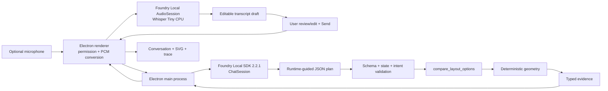
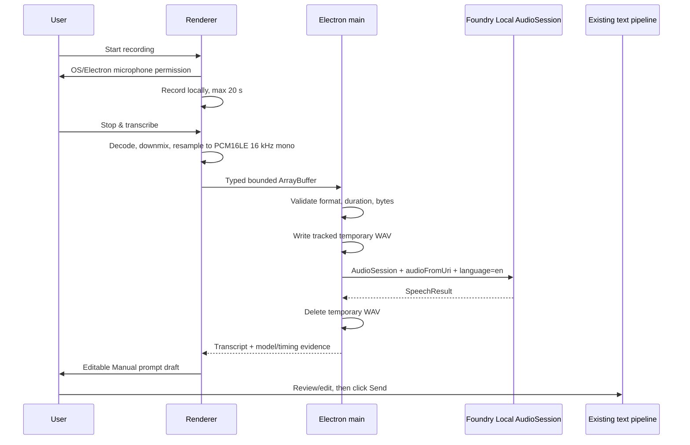
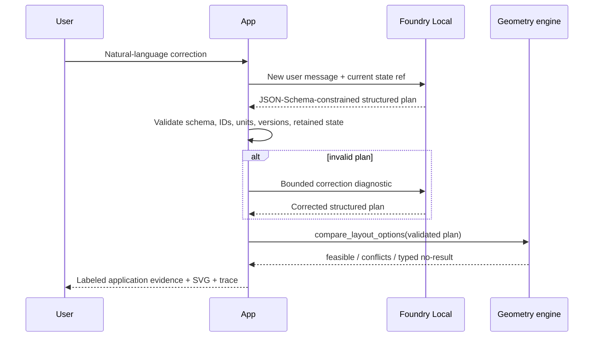

# Architecture

## Responsibility boundary



**Foundry Local owns**

- local English speech-to-text through a separate `AudioSession`;
- multi-turn language interpretation;
- proposing catalog IDs and retained furniture;
- emitting a structured plan under runtime JSON Schema guidance;
- preserving conversation history inside one `ChatSession`;
- local model loading and hardware-accelerated inference.

**The application owns**

- explicit microphone permission UX, 20-second capture bound, and typed IPC validation;
- local PCM conversion, temporary WAV lifecycle, and transcript-as-draft behavior;
- verified room, zone, rule, and furniture dimensions;
- accepted state and stale-state references;
- strict ID/unit/version/schema checks;
- explicit Queen/King/crib negation and correction guards;
- bounded option enumeration;
- geometry, collision, clearance, and no-result decisions;
- the visible application-evidence response and SVG.

The model never decides whether geometry is valid.

## Optional local audio input



Pinned v2.2.1 accepts Whisper file transcription by URI. A measured inline
`Item.audioFromData("wav", bytes)` request failed with:

> Inline audio data without streaming (ItemQueue) is not yet supported.

The app therefore uses a bounded temporary WAV under a dedicated OS app temp directory. It deletes
the tracked file on normal success, failure, reset, and clean quit. If shutdown is bounded by an
active native request or the file is locked, cleanup remains explicitly pending and the next launch
purges only this app's matching `capture-*.wav` files. Renderer code never receives filesystem or
Node access.

Audio readiness is separate from layout-model readiness. The microphone control becomes stage-ready
only when both exact model dependencies are loaded. Speech output is trace evidence, not a command:
it never invokes `compare_layout_options` until the user reviews and submits the text.

### ASR candidate evidence

| Model | Catalog status before evaluation | Size / device / EP | v2.2.1 API path | Measured result |
|---|---|---|---|---|
| `openai-whisper-tiny-generic-cpu:4` | Cached | 131 MB / CPU / CPU EP | `AudioSession` file URI | Exact text; 169–279 ms |
| `openai-whisper-base-generic-cpu:3` | Cached | 205 MB / CPU / CPU EP | `AudioSession` file URI | Exact text; 362–427 ms |
| `nemotron-speech-streaming-en-0.6b-generic-cpu:3` | Uncached, downloaded only for benchmark, then removed | 696 MB / CPU / CPU EP | `AudioSession` PCM `ItemQueue`; pinned JS live sample also exposes deprecated live adapter | Exact text; first live segment 1.29 s, stop-to-final 189 ms, buffered 932–971 ms |
| `nemotron-3.5-asr-streaming-0.6b-generic-cpu:3` | Uncached, not downloaded | 756 MB / CPU / CPU EP | Pinned live PCM path | Not tested; multilingual/Chinese not claimed |

Whisper Tiny and Nemotron had comparable stop-to-final latency in the measured paths. Whisper Tiny
won for this exact **record-then-transcribe** experience because it was already cached, its offline
footprint is roughly one fifth of the English Nemotron model, its buffered benchmark was faster, and
the UI does not use live partial text. A future live-caption feature should re-evaluate Nemotron.

## One turn



The correction loop is capped at three attempts. A fourth blind generation is never made.

## Structured plan contract

The runtime-guided plan corresponds to `compare_layout_options`:

```json
{
  "roomPlanId": "ignite-bedroom-a",
  "planVersion": "2026-10-27.1",
  "priorStateRef": "layout-state-v2",
  "clearanceRuleSetId": "ignite-demo-clearance",
  "clearanceRuleSetVersion": "1.0.0",
  "requiredRoomStateSetId": "all-required-room-states-v1",
  "lockedConstraintSetId": "verified-bedroom-locks-v1",
  "unit": "mm",
  "candidateFurnitureIds": {
    "bed": "bed-queen",
    "desk": "desk-compact",
    "crib": "crib-standard"
  },
  "retainFurnitureIds": ["bed-queen"],
  "changedPreference": "Keep the Queen and add a crib.",
  "unknowns": [],
  "clarificationNeeded": false
}
```

The slot object prevents duplicate beds/desks while retaining exact catalog IDs. The application
rejects:

- stale `priorStateRef`;
- wrong room/rule versions;
- unsupported units;
- invented IDs;
- retained IDs not active in the previous state;
- active unchanged IDs omitted from `retainFurnitureIds`;
- explicit King/Queen/crib corrections that the model dropped;
- verified door/closet/window/catalog facts incorrectly marked unknown.

Unsupported catalog terms such as `dresser` or `nightstand` force
`clarificationNeeded=true` and a typed missing-dimensions result. Geometry does not run.

## Deterministic geometry

Coordinate system:

- origin: room's north-west corner;
- unit: millimetres;
- room: `4200 x 3600`;
- entry door: 900 mm north-east quarter-circle swing from the south-west hinge;
- closet access zone: `x=3200..4200`, `y=450..2750`;
- window clearance zone: `x=1400..2800`, `y=0..450`;
- minimum furniture gap: 250 mm.

Checks:

1. Footprint inside room bounds.
2. Rectangle vs door-swing quarter circle.
3. Rectangle vs closet/window reserved rectangles.
4. Rectangle vs rectangle collision.
5. Euclidean edge-to-edge furniture distance.

Touching a reserved rectangle boundary is clear; positive overlap is blocked. Touching the
door-swing radius is blocked. Exactly 250 mm furniture clearance passes.

## Bounded known options

The app deliberately evaluates a small fixture set rather than claiming global optimization:

| Furniture set | Known option | Result |
|---|---|---|
| Queen + standard desk | Rotated standard desk | Feasible |
| King + standard desk | Desk shifted east | Closet conflict |
| Queen + compact desk + crib | Rotated compact desk | Feasible |
| King + compact desk + crib | East and south alternatives | All rejected |
| Queen + compact desk | Crib removed | Feasible |

If the exact combination has no verified option set, the tool returns
`NO_KNOWN_OPTION_SET`; it never invents coordinates. If an accepted layout already exists, the UI
labels it as the retained accepted layout rather than misrepresenting it as a rejected option.

For rejected alternatives, top-level checks and conflicts are tied to `evidenceOptionId`, the exact
option rendered in the SVG. Deduplicated reasons across all rejected alternatives live in
`aggregateConflicts` and are labeled as aggregate evidence in the trace and application response.

## Why not native `ToolCallItem` for this milestone

The application first implemented the v2.2.1 native function-tool API:

- `ChatSession.addToolDefinition`;
- `toolChoice: "required"`;
- `parallel_tool_calls=false`;
- typed `ToolCallItem` and `ToolResultItem`.

On the cached candidates:

- Qwen3 0.6B exhausted its 2,048-token output budget without a call.
- Qwen3 1.7B was initially dominated by reasoning; disabling thinking fixed latency but it dropped
  the crib correction.
- Qwen2.5 0.5B emitted wrong argument types and empty state refs.
- Qwen2.5 Coder 1.5B emitted interrupted calls.
- Qwen2.5 1.5B emitted duplicate parallel calls or dropped replacements.

The chosen fallback still uses the current `ChatSession` API and runtime grammar, but the model emits
the argument object as JSON rather than a native tool marker. The app invokes the tool explicitly and
labels this mode in the UI. This is the bounded structured-output option from the agreed escalation
path, not a hidden fake.

## Process and cleanup

1. Create one `FoundryLocalManager`.
2. Resolve exact model ID `qwen2.5-1.5b-instruct-generic-gpu:4` from the public catalog.
3. Resolve exact audio ID `openai-whisper-tiny-generic-cpu:4` from the same manager/catalog.
4. Download either exact model once if its bounded preparation is approved and the cache is empty.
5. Match/register WebGPU for text; CPU EP is built in for Whisper Tiny.
6. Load the two models independently and expose separate readiness.
7. Keep one planning `ChatSession`; create/dispose one `AudioSession` per reviewed capture.
8. Cancel active ASR, delete tracked temp files, and unload Whisper on reset.
9. Keep reset-timeout sessions quarantined until the captured request settles and an automatic
   session replacement succeeds; require an explicit Reset retry if replacement fails.
10. Dispose sessions, unload both models, then dispose the manager on clean quit.
11. On startup, remove only owned `capture-*.wav` orphans from the dedicated audio temp directory;
    retain locked files for a later cleanup retry and leave unrelated files untouched.

Electron's `before-quit` handler waits for bounded cleanup before exiting. A timeout or locked-file
failure is logged as an unclean shutdown with a nonzero exit code; any owned capture obligation is
left discoverable for next-launch recovery rather than reported as clean.

## Cross-platform status

The code uses Electron, Node paths, and the cross-platform JavaScript SDK. The built-in stage target
is exact and has no best-cached fallback. Alternate targets require both an exact
`FOUNDRY_MODEL_ID` and `FOUNDRY_EXECUTION_PROVIDER`; readiness and the UI identify them as
environment overrides and do not imply stage validation. No Apple-silicon Mac was available, so
macOS packaging, model variant selection, EP registration, layout fidelity, and performance remain
unvalidated.
