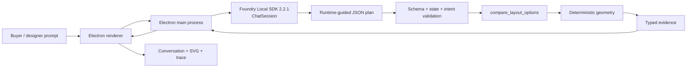
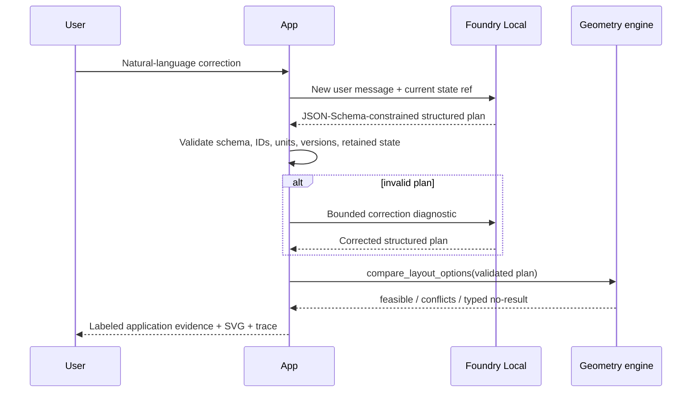

# Architecture

## Responsibility boundary



**Foundry Local owns**

- multi-turn language interpretation;
- proposing catalog IDs and retained furniture;
- emitting a structured plan under runtime JSON Schema guidance;
- preserving conversation history inside one `ChatSession`;
- local model loading and hardware-accelerated inference.

**The application owns**

- verified room, zone, rule, and furniture dimensions;
- accepted state and stale-state references;
- strict ID/unit/version/schema checks;
- explicit Queen/King/crib negation and correction guards;
- bounded option enumeration;
- geometry, collision, clearance, and no-result decisions;
- the visible application-evidence response and SVG.

The model never decides whether geometry is valid.

## One turn



The correction loop is capped at three attempts. A fourth blind generation is never made.

## Structured plan contract

The runtime-guided plan corresponds to `compare_layout_options`:

```json
{
  "roomPlanId": "ignite-bedroom-a",
  "planVersion": "2026-10-27.1",
  "priorStateRef": "layout-state-v2",
  "clearanceRuleSetId": "ignite-demo-clearance",
  "clearanceRuleSetVersion": "1.0.0",
  "requiredRoomStateSetId": "all-required-room-states-v1",
  "lockedConstraintSetId": "verified-bedroom-locks-v1",
  "unit": "mm",
  "candidateFurnitureIds": {
    "bed": "bed-queen",
    "desk": "desk-compact",
    "crib": "crib-standard"
  },
  "retainFurnitureIds": ["bed-queen"],
  "changedPreference": "Keep the Queen and add a crib.",
  "unknowns": [],
  "clarificationNeeded": false
}
```

The slot object prevents duplicate beds/desks while retaining exact catalog IDs. The application
rejects:

- stale `priorStateRef`;
- wrong room/rule versions;
- unsupported units;
- invented IDs;
- retained IDs not active in the previous state;
- active unchanged IDs omitted from `retainFurnitureIds`;
- explicit King/Queen/crib corrections that the model dropped;
- verified door/closet/window/catalog facts incorrectly marked unknown.

Unsupported catalog terms such as `dresser` or `nightstand` force
`clarificationNeeded=true` and a typed missing-dimensions result. Geometry does not run.

## Deterministic geometry

Coordinate system:

- origin: room's north-west corner;
- unit: millimetres;
- room: `4200 x 3600`;
- entry door: 900 mm north-east quarter-circle swing from the south-west hinge;
- closet access zone: `x=3200..4200`, `y=450..2750`;
- window clearance zone: `x=1400..2800`, `y=0..450`;
- minimum furniture gap: 250 mm.

Checks:

1. Footprint inside room bounds.
2. Rectangle vs door-swing quarter circle.
3. Rectangle vs closet/window reserved rectangles.
4. Rectangle vs rectangle collision.
5. Euclidean edge-to-edge furniture distance.

Touching a reserved rectangle boundary is clear; positive overlap is blocked. Touching the
door-swing radius is blocked. Exactly 250 mm furniture clearance passes.

## Bounded known options

The app deliberately evaluates a small fixture set rather than claiming global optimization:

| Furniture set | Known option | Result |
|---|---|---|
| Queen + standard desk | Rotated standard desk | Feasible |
| King + standard desk | Desk shifted east | Closet conflict |
| Queen + compact desk + crib | Rotated compact desk | Feasible |
| King + compact desk + crib | East and south alternatives | All rejected |
| Queen + compact desk | Crib removed | Feasible |

If the exact combination has no verified option set, the tool returns
`NO_KNOWN_OPTION_SET`; it never invents coordinates.

## Why not native `ToolCallItem` for this milestone

The application first implemented the v2.2.1 native function-tool API:

- `ChatSession.addToolDefinition`;
- `toolChoice: "required"`;
- `parallel_tool_calls=false`;
- typed `ToolCallItem` and `ToolResultItem`.

On the cached candidates:

- Qwen3 0.6B exhausted its 2,048-token output budget without a call.
- Qwen3 1.7B was initially dominated by reasoning; disabling thinking fixed latency but it dropped
  the crib correction.
- Qwen2.5 0.5B emitted wrong argument types and empty state refs.
- Qwen2.5 Coder 1.5B emitted interrupted calls.
- Qwen2.5 1.5B emitted duplicate parallel calls or dropped replacements.

The chosen fallback still uses the current `ChatSession` API and runtime grammar, but the model emits
the argument object as JSON rather than a native tool marker. The app invokes the tool explicitly and
labels this mode in the UI. This is the bounded structured-output option from the agreed escalation
path, not a hidden fake.

## Process and cleanup

1. Create one `FoundryLocalManager`.
2. Select an exact cached variant.
3. Register only its required EP.
4. Load the model once.
5. Keep one planning `ChatSession` per conversation.
6. Dispose the session.
7. Unload the model.
8. Dispose the manager.

Electron's `before-quit` handler waits for cleanup before exiting.

## Cross-platform status

The code uses Electron, Node paths, and the cross-platform JavaScript SDK. The model selector asks the
catalog for the best cached variant and supports environment overrides. No Apple-silicon Mac was
available, so macOS packaging, model variant selection, EP registration, layout fidelity, and
performance remain unvalidated.
