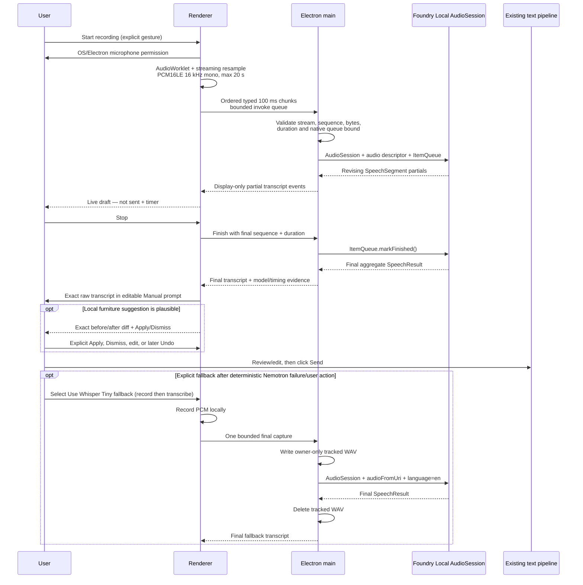

# Architecture

## Responsibility boundary

```mermaid
flowchart LR
  MIC[Optional microphone] --> R[Electron renderer<br/>permission + PCM conversion]
  R --> ASR[Foundry Local AudioSession<br/>Nemotron live PCM ItemQueue]
  R -. explicit fallback .-> W[Use Whisper Tiny fallback<br/>(record then transcribe)]
  ASR --> D[Editable transcript draft]
  W --> D
  D --> U[User review/edit + Send]
  U --> R
  R --> M[Electron main process]
  M --> FL[Foundry Local SDK 2.2.1<br/>ChatSession]
  FL --> P[Runtime-guided semantic intent delta]
  P --> V[Prompt validation + full tool-input derivation]
  V --> T[compare_layout_options]
  T --> G[Deterministic geometry]
  G --> E[Typed evidence]
  E --> M
  M --> R
  R --> S[Conversation + SVG + trace]
```

**Foundry Local owns**

- local English speech-to-text through a separate `AudioSession`, with exact Nemotron live
  streaming as the default and exact Whisper Tiny as an explicit fallback;
- multi-turn language interpretation;
- emitting only bed/desk/internal-crib intent changes and clarification under runtime JSON Schema guidance;
- preserving conversation history inside one `ChatSession`;
- local model loading and hardware-accelerated inference.

**The application owns**

- explicit microphone permission UX, 20-second capture bound, `AudioWorklet` PCM conversion,
  ordered typed IPC, renderer and native queue bounds, and transcript-as-draft behavior;
- partial subtitle replacement for display only, raw final transcript retention, a visible narrow
  user-accepted speech-suggestion layer, and the explicit Whisper fallback policy;
- owner-only temporary WAV lifecycle for Whisper fallback;
- verified room, zone, rule, and furniture dimensions;
- accepted state and stale-state references;
- exact catalog-ID selection, retained furniture, versions, units, locked constraints, required
  room-state checks, and unsupported-term evidence;
- strict schema and derived full-tool-input checks;
- explicit Queen/King/baby-bed alias negation and correction guards;
- bounded option enumeration;
- geometry, collision, exact clearance measurements, and no-result decisions;
- app-owned snapped direct manipulation with stale-safe Apply/Revert;
- the visible application-evidence response, requirements panel, dimension callouts, and SVG.

The model never decides whether geometry is valid.

## Optional local audio input



The default path uses the v2.2.1 native `AudioSession` PCM `ItemQueue` contract directly. The request
borrows the queue; the app marks it finished, waits for both the async item stream and terminal
`response`, then disposes the queue and session. The renderer allows at most eight queued 100 ms
chunks, main accepts at most 200 chunks for the 20-second capture, and both layers reject invalid
stream UUIDs, stale/out-of-order chunks, byte-count mismatches, and a full native queue. Cancellation
uses the v2.2.1 streaming abort signal plus request cancellation and remains under the existing
bounded reset/shutdown drain and quarantine rules. Main also owns a renderer-frame lease containing
the captured `webContents`, frame identity, ownership-session ID, and stream ID. Main-frame
navigation/reload, renderer loss, webContents destruction, or window close revokes the lease,
cancels native streaming, and prevents old partials from being delivered to a replacement renderer.
Reset uses the same ownership authority: the renderer blocks input and releases local tracks first;
renderer and controller accepted state advance synchronously to a persisted reset generation and v0.
Main revokes any lease for that `webContents` while controller/native reset starts, then awaits the
bounded cancellation path. Ownership release is immediate and repeated revoke/reset calls are safe,
while a late stream activation is canceled against its revoked lease. A timeout never restores the
prior accepted layout or trace: v0 remains quarantined, and automatic readiness recovery is accepted
only when it reports the same reset generation.

Pinned v2.2.1 accepts Whisper fallback transcription by URI. A measured inline
`Item.audioFromData("wav", bytes)` request failed with:

> Inline audio data without streaming (ItemQueue) is not yet supported.

The fallback therefore uses a bounded owner-only temporary WAV under a dedicated OS app temp
directory. It deletes the tracked file on normal success, failure, reset, and clean quit. If
shutdown is bounded by an active native request or the file is locked, cleanup remains explicitly
pending and the next launch purges only this app's matching `capture-*.wav` files. Renderer code
never receives filesystem or Node access.

Audio readiness is separate from layout-model readiness. The microphone control becomes stage-ready
only when both exact default model dependencies are loaded. Speech output is trace evidence, not a
command: live partials never enter the prompt, and the final transcript never invokes
`compare_layout_options` until the user reviews and submits the text. Mode switching first resolves,
validates, and loads the requested target before unloading the working model. A failed target
resolution reports the requested mode as not ready while retaining the prior working model for an
explicit recovery selection.

### ASR candidate evidence

| Model | Validated role | Size / device / EP | v2.2.1 API path | Measured result |
|---|---|---|---|---|
| `openai-whisper-tiny-generic-cpu:4` | Explicit fallback | 131 MB / CPU / CPU EP | `AudioSession` file URI | Exact text; cached prepare 4.035 s; transcription 221 ms |
| `openai-whisper-base-generic-cpu:3` | Evaluated candidate | 205 MB / CPU / CPU EP | `AudioSession` file URI | Exact text; 362–427 ms |
| `nemotron-speech-streaming-en-0.6b-generic-cpu:3` | Default | 696 MB / CPU / CPU EP | v2.2.1 `AudioSession` PCM `ItemQueue` | 31 revisions; first partial 1.248 s; stop-to-final 205 ms; cached prepare 5.482 s; exact words |
| `nemotron-3.5-asr-streaming-0.6b-generic-cpu:3` | Not evaluated | 756 MB / CPU / CPU EP | Pinned live PCM path | Not tested; multilingual/Chinese not claimed |

These are candidate-evaluation measurements from their recorded runs; the current release
checkpoint is in [VALIDATION.md](VALIDATION.md).

Nemotron is the default because the stage UI renders its revising partials. Whisper Tiny remains
available for its smaller footprint and fast final-only transcription, but switching requires the
visible **Use Whisper Tiny fallback (record then transcribe)** control. No code path silently
substitutes it.

Current validation covers worklet startup cleanup, generation-tagged renderer/main state-v0 reset,
renderer reset concurrency, active-stream ownership revocation, cancellation failure/timeout
recovery, stale bootstrap/result rejection, atomic failed-mode switching, submitted-transcript
state, bounded cancellation/reset recovery, stale chunk/partial rejection, direct-action token-span
speech suggestions, manual placement/retention, and the complete-Qwen-response execution gate. The
Electron Reset probe uses the real renderer buttons, a controlled WAV-backed MediaStream,
production IPC/controller/owner code, and a real Nemotron `AudioSession`. The separate stream-owner
probe records through the same production path before reload navigation and window close, then
asserts renderer-track and native ownership cancellation, session advancement, and stale-route
rejection.

## One turn

```mermaid
sequenceDiagram
  participant U as User
  participant A as App
  participant F as Foundry Local
  participant G as Geometry engine

  U->>A: Natural-language correction
  A->>F: New user message + current state ref
  F-->>A: JSON-Schema-constrained semantic intent delta
  A->>A: Require terminal finishReason=stop
  A->>A: Validate prompt intent; derive IDs, versions,<br/>units, constraints, retained state
  alt invalid plan
    A->>F: Bounded correction diagnostic
    F-->>A: Corrected semantic delta
  end
  A->>G: compare_layout_options(app-derived full input)
  G-->>A: feasible / conflicts / typed no-result
  A-->>U: Labeled application evidence + SVG + trace
```

The correction loop is capped at three attempts. A fourth blind generation is never made.
`finishReason: "length"` is treated as truncated output even if its text happens to parse as JSON;
partial JSON is rolled back and never reaches geometry.

## Intent-delta and tool contracts

The runtime-guided model output is deliberately small:

```json
{
  "bed": "queen",
  "desk": "flexible",
  "crib": "add",
  "clarification": "none"
}
```

The schema has no catalog IDs, state references, dimensions, coordinates, fit status, conflicts, or
geometry verdict, and it never asks the model to echo arbitrary user text. From that delta, the exact
submitted prompt, and the authoritative current state, application code derives the existing strict
`CompareLayoutOptionsInput`, including:

- the exact submitted prompt in application-owned `changedPreference`;
- exact room/rule/state-set versions and millimetre units;
- exact `bed-*`, `desk-*`, and optional `crib-standard` catalog IDs;
- active unchanged IDs in `retainFurnitureIds`;
- the current `priorStateRef`;
- locked constraints and required checks;
- exact unsupported terms and typed missing-dimension messages.

The application rejects:

- stale `priorStateRef`;
- wrong room/rule versions;
- unsupported units;
- invented IDs;
- retained IDs not active in the previous state;
- active unchanged IDs omitted from `retainFurnitureIds`;
- explicit directional replacements, keep/add/remove instructions, and scoped negation that the
  model dropped;
- target replacements inferred from clearly negated `replace` or `from ... to ...` transitions;
- conflicting or transition-inconsistent wording unless clarification is requested;
- verified door/closet/window/catalog facts incorrectly marked unknown.

Furniture recognition is fail-closed against the supported catalog vocabulary: Queen/King bed,
standard/compact/flexible desk, and baby bed. `baby bed`, `baby-bed`, `baby cot`, and technical
`crib` map to stable `crib-standard`. Action-object parsing recognizes unsupported variants and
objects such as California King, twin bed, moon pod, `armchair`, `cabinet`, `bassinet`, `night
stand`, or another likely furniture noun after add/use/replace/fit/put. These force clarification
plus application-derived `unknowns` and `clarificationNeeded=true`; supported intent in the same
request is preserved. Ordinary layout, clearance, and adjective prose is excluded. Geometry does
not run.

## Deterministic geometry

Coordinate system:

- origin: room's north-west corner;
- unit: millimetres;
- room: `4200 x 3600`;
- entry door: 900 mm north-east quarter-circle swing from the south-west hinge;
- closet access zone: `x=3200..4200`, `y=450..2750`;
- window clearance zone: `x=1400..2800`, `y=0..450`;
- minimum furniture gap: 250 mm.

Checks:

1. Footprint inside room bounds.
2. Rectangle vs door-swing quarter circle.
3. Rectangle vs closet/window reserved rectangles.
4. Rectangle vs rectangle collision.
5. Euclidean edge-to-edge furniture distance.

Touching a reserved rectangle boundary is clear; positive overlap is blocked. Touching the
door-swing radius is blocked. Exactly 250 mm furniture clearance passes.

## Bounded known options

The app deliberately evaluates a small fixture set rather than claiming global optimization:

| Furniture set | Known option | Result |
|---|---|---|
| Queen + standard desk | Rotated standard desk | Feasible |
| King + standard desk | Desk shifted east | Closet conflict |
| Queen + compact desk + baby bed | Rotated compact desk | Feasible |
| King + compact desk + baby bed | East and south alternatives | All rejected |
| Queen + compact desk | Baby bed removed | Feasible |

If the exact combination has no verified option set, the tool returns
`NO_KNOWN_OPTION_SET`; it never invents coordinates. If an accepted layout already exists, the UI
labels it as the retained accepted layout rather than misrepresenting it as a rejected option.

For rejected alternatives, top-level checks and conflicts are tied to `evidenceOptionId`, the exact
option rendered in the SVG. Deduplicated reasons across all rejected alternatives live in
`aggregateConflicts` and are labeled as aggregate evidence in the trace and application response.

## Why not native `ToolCallItem` for this milestone

The application first implemented the v2.2.1 native function-tool API:

- `ChatSession.addToolDefinition`;
- `toolChoice: "required"`;
- `parallel_tool_calls=false`;
- typed `ToolCallItem` and `ToolResultItem`.

The full-input/native-call path was slow or unreliable because small models had to repeat
state references, versions, catalog IDs, and constraint fields. The compact contract removes those
application-owned fields from model generation. Under the unrestricted-enum gate,
`qwen3-0.6b-generic-gpu:2` passed all 18 required semantic scenarios, including baby-bed aliases,
negated transitions, and unsupported California King, twin-bed, and moon-pod requests, and remains
the stage-validated built-in default. No other candidate has equivalent gate evidence.

The chosen fallback still uses the current `ChatSession` API and runtime grammar, but the model emits
the argument object as JSON rather than a native tool marker. The app invokes the tool explicitly and
labels this mode in the UI. This is the bounded structured-output option from the agreed escalation
path, not a hidden fake.

## Process and cleanup

1. Create one `FoundryLocalManager`.
2. Resolve exact model ID `qwen3-0.6b-generic-gpu:2` from the public catalog.
3. Resolve exact default audio ID `nemotron-speech-streaming-en-0.6b-generic-cpu:3` from the same
   manager/catalog; resolve Whisper Tiny only after explicit fallback selection.
4. Download either exact model once if its bounded preparation is approved and the cache is empty.
5. Match/register WebGPU for text; CPU EP is built in for both ASR variants.
6. Load text and the selected audio model independently and expose separate readiness.
7. Keep one planning `ChatSession`; create/dispose one `AudioSession` plus `ItemQueue` per Nemotron
   stream, or one `AudioSession` per reviewed Whisper capture.
8. Cancel active ASR, settle native stream/response work, delete tracked fallback files, and unload
   the selected audio model on reset.
9. Keep reset-timeout sessions quarantined until the captured request settles and an automatic
   session replacement succeeds; require an explicit Reset retry if replacement fails.
10. Dispose sessions, unload both models, then dispose the manager on clean quit.
11. On startup, remove only owned `capture-*.wav` orphans from the dedicated audio temp directory;
    retain locked files for a later cleanup retry and leave unrelated files untouched.

Electron's `before-quit` handler waits for bounded cleanup before exiting. A timeout or locked-file
failure is logged as an unclean shutdown with a nonzero exit code; any owned capture obligation is
left discoverable for next-launch recovery rather than reported as clean.

## Cross-platform status

The code uses Electron, Node paths, and the cross-platform JavaScript SDK. The built-in stage target
is exact and has no best-cached fallback. Alternate targets require both an exact
`FOUNDRY_MODEL_ID` and `FOUNDRY_EXECUTION_PROVIDER`; readiness and the UI identify them as
environment overrides and do not imply stage validation. macOS packaging, model variant selection,
EP registration, layout fidelity, and performance remain unvalidated; no Apple-silicon evidence is
recorded.
