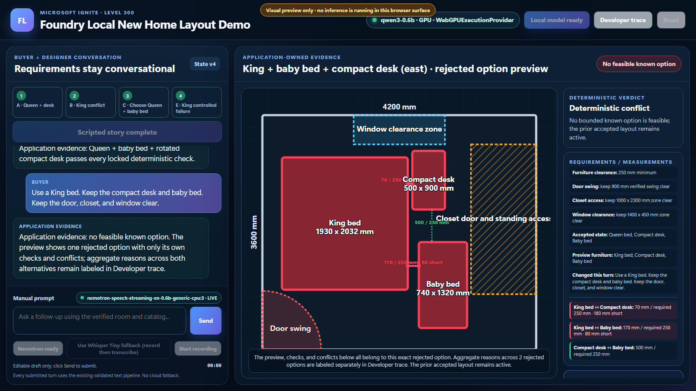

# Enhanced New Home App

Enhanced New Home App extends
[New Home App](https://github.com/Wayne-Ch/foundry-local-new-home-app)
and its [standard guide](https://github.com/Wayne-Ch/foundry-local-new-home-app/blob/main/README.md).
It keeps the standard local planning, deterministic geometry, furniture controls, voice input, and
Reset lifecycle while adding these Enhanced-only capabilities:

- a fresh no-room intake state;
- exact sample floor-plan image preview and byte-identity validation;
- local VLM topology analysis before any imported geometry appears;
- imported-room A/B/C/D/E planning with door, window, closet, and clearance constraints;
- an explicit **Use default room** fallback that is never reported as a successful import.



> **Playtest Enhanced New Home App:** follow the top-to-bottom
> [PLAYTEST.md](PLAYTEST.md) for the exact fixture boundary, full A/B/C/D/E story, visible
> checkpoints, explicit default-room boundary, and adjacent stop conditions.

## What is real

- **Inference:** `foundry-local-sdk@2.2.1`, in-process through `ChatSession`.
- **Default model target:** exact catalog ID `qwen3-0.6b-generic-gpu:2`.
- **Execution provider:** `WebGPUExecutionProvider`, registered from the Foundry Local
  `webgpu-ep-0.2.1-win-x64` bundle.
- **Default live speech-to-text:** exact catalog ID
  `nemotron-speech-streaming-en-0.6b-generic-cpu:3` through native v2.2.1 `AudioSession`,
  PCM `ItemQueue`, `CPUExecutionProvider`, English only.
- **Bounded live PCM path:** after an explicit button click and permission grant, an
  `AudioWorklet` captures microphone frames, the renderer resamples them to PCM16LE/16 kHz/mono,
  and a typed `ipcRenderer.invoke` pump preserves chunk order with an eight-chunk bound. Main
  validates stream identity, sequence, chunk size, total bytes, and native queue capacity before
  pushing each copied `Item.bytes(...)` frame.
- **Main-owned stream lifecycle:** main captures the initiating `webContents`, frame, ownership
  session, and stream ID. Navigation, reload, renderer loss, frame/webContents destruction, or
  window close revokes that owner and cancels the stream; partials can only return to the captured
  frame and never a replacement renderer. Reset immediately advances renderer and controller state
  to a generation-tagged v0, clears accepted/transient evidence, and releases microphone tracks.
  Main revokes the whole `webContents` lease while the authoritative controller reset starts, then
  awaits bounded native cancellation. A timeout stays v0 and quarantined; automatic readiness
  recovery can re-enable controls only for that same v0 generation. Repeated cleanup is idempotent.
- **Explicit fallback:** exact `openai-whisper-tiny-generic-cpu:4` is available only through the
  visibly labeled **Whisper Tiny fallback (record then transcribe)** action. The stage default
  remains Nemotron; the fallback loads only after that explicit user choice and never activates
  silently.
- **Transcript review:** speech text is placed into the editable Manual prompt. It is never
  auto-submitted and never bypasses the existing structured planning/tool pipeline. On Send, the
  display transitions from `Live draft — not sent` to the exact edited submitted prompt. The raw ASR
  transcript remains in Developer trace. A narrow, visible suggestion layer can correct
  `queen size bag` -> `queen-size bed` only when a nearby recognized furniture action directly
  governs the candidate. Negation and luggage cues are evaluated only in that candidate's governing
  action span and local modifiers, so an earlier `do not move...` or `packed luggage...` clause does
  not suppress a later positive `fit...` clause. `creep` -> `baby bed` is narrower: it requires a
  direct additive, request, placement, or replacement action such as add, bring, fit, need, place,
  replace, or want plus local baby/nursery/layout evidence. Keep/move/remove person wording remains
  literal, as do quoted text, local luggage wording, punctuated/adverb-interrupted negation, and exact
  `baby bed`. The editable prompt initially preserves the exact raw transcript. **Apply suggested
  furniture corrections** is the only action that changes it; **Dismiss** leaves it raw, and an
  applied suggestion remains undoable.
- **Structured planning:** Foundry Local runtime-enforced JSON Schema output contains only a compact
  semantic intent delta (`bed`, `desk`, internal `crib`, and clarification). Audience prompts use
  **baby bed**; `baby bed`, `baby-bed`, `baby cot`, and `crib` map to the stable
  `crib-standard` catalog intent. Every supported compact intent
  value remains available in the runtime schema; application code injects the exact submitted prompt
  as `changedPreference` and validates the model choice against explicit wording and accepted state,
  including directional replacements, scoped negation, ambiguity, and fail-closed unsupported
  furniture. Clearly negated replacements preserve the accepted item; ambiguous multi-action
  negation requires clarification and preserves every slot. Action-object extraction distinguishes
  unsupported variants such as California King and twin beds from the supported regular King,
  without treating clearance prose as furniture. The app then derives exact catalog IDs, retained
  state, versions, units, locked constraints, and bounded clarification evidence before invoking
  `compare_layout_options`. Length-truncated or otherwise partial JSON is rejected and never
  executed.
- **Geometry:** application-owned room bounds, door swing, reserved-zone overlap, furniture
  collision, 250 mm furniture-clearance checks, and exact pair measurements for accepted or rejected
  options.
- **Direct manipulation:** accepted SVG furniture is pointer- and keyboard-adjustable on a bounded
  50 mm grid. Every displayed bed, standard/compact desk, and baby bed remains selectable while a
  preview is pending. Clicking establishes accessible focus that survives SVG redraws, so arrow-key
  previews continue updating geometry and measurements. Dragging shows an app-owned ghost preview;
  Apply revalidates and creates a new accepted application layout version, while invalid placement
  remains a labeled rejected preview until Revert.
- **Rendering:** Electron renderer with an SVG room plan, visible requirements/measurements,
  dimension callouts for exact gaps or shortfalls, and an inspectable structured trace.
- **Failure evidence:** one rejected preview is always rendered with checks and conflicts from that
  same option. Cross-option rejection reasons are separate in the typed result and developer trace.

There is no cloud inference or speech endpoint, OS online speech service, CLI subprocess,
image-generation pipeline, hidden canned model response, TTS, or success-shaped fallback.

## Optional experimental floor-plan import

The Enhanced product branch starts in an explicit no-room intake state. **Load sample floor plan** shows only
the bounded image preview; deterministic room geometry becomes active only after **Analyze layout**
succeeds. **Use default room** remains an explicit fallback that activates the original verified
bedroom. The main process owns image selection and bytes; the renderer receives only a bounded
data-URL preview and recognized facts, never a filesystem path.
**Choose exact fixture copy** exists only for a byte-for-byte copy of the same packaged PNG. A
renamed file is acceptable only when its bytes remain identical; re-encoded or arbitrary drawings
are rejected before analysis.

- Exact vision model: `qwen3.5-0.8b-generic-cpu:3`.
- Task / device / EP: `vision-language-chat` / CPU / `CPUExecutionProvider`.
- SDK path: the existing in-process `foundry-local-sdk@2.2.1` manager plus a separate short-lived
  `ChatSession`; no cloud or loopback endpoint.
- Input gate: general magic/byte/dimension/pixel checks run first, then the app requires the exact
  packaged PNG identity: `1020 x 1080`, `194,686` bytes, and SHA-256
  `02c90be495d1f64e8adb57c4d00eb81f09fbeb80e885a0066f692026d2145587`.
  White, rectangle-only, re-encoded, modified, JPEG, WebP, SVG, HTML, PDF, Office/ZIP, mislabeled,
  and `SharedArrayBuffer` inputs cannot receive canonical geometry.
- After exact source identity passes, main decodes and re-encodes the preview as PNG, verifies
  decoded/header dimensions agree, and creates a separate inference PNG capped at 1,280 px on its
  longest side. Preparation buffers, preview bytes after data-URL creation, inference copies, and
  staged source bytes have independent zero-fill ownership.
- Contract: non-forced categorical alternatives. `roomShape` is
  `rectangle|not_rectangle|uncertain`; room label, door opening, and window opening are each
  `present|absent|uncertain`. Import requires a visible rectangular labeled room with a door and
  window. Missing, negative, uncertain, duplicate, or extra evidence rejects.
- The exact neutral prompt treats each field as independent visible evidence and does not assume the
  image is a floor plan. Output is deterministic (`temperature=0`, `seed=42`), bounded to 320
  tokens, JSON-schema guided, tool-free, and thinking-disabled. It must finish with `stop`; at most
  one fresh-session retry uses the identical prompt and budget. Invalid JSON, repetition,
  truncation, or content mismatch fails closed.
- Geometry: only after exact fixture identity and visible-topology acceptance, the app applies this
  one fixture's documented
  approximately `11'-10 3/4" x 13'-0"` scale as `3650 x 3950 mm` and canonical one-door,
  closet-access, and exterior-window zones. Existing collision, door-swing, clearance, manual
  placement, voice intent, Reset, and stale-result rules remain authoritative.
- Cleanup: each inference copy and the main-owned source buffer is zero-filled. Reset returns to the
  fresh no-room intake state. Default-room selection, reload, renderer loss, window close, and
  shutdown cancel stale work and clear preview ownership.

The fixture is intentionally narrow. It is not arbitrary architectural-plan support. It is an
empty `MASTER BEDROOM` crop with one door, exterior window detail, built-in wall/closet detail, and
printed dimensions. The VLM recognizes topology only; the application owns all geometry.

### Fixture source and license

| Item | Value |
|---|---|
| Canonical source | [Wikimedia Commons: `400 Family Housing Units 2 Bedroom Unit Typical Floor Plans, July 24, 1989`](https://commons.wikimedia.org/wiki/File:400_Family_Housing_Units_2_Bedroom_Unit_Typical_Floor_Plans,_July_24,_1989_-_DPLA_-_c7a8b82ce8562d0a20b33b02d2f5f6fd.tiff) |
| Author / archive | U.S. federal architectural record held by the National Archives and Records Administration; specific drafter not identified in the fixture metadata |
| IDs | NARA `167060897`; DPLA `c7a8b82ce8562d0a20b33b02d2f5f6fd` |
| License | Commons marks the work `PD-US`; attribution is not required. Public-domain status may differ outside the United States, so downstream users must assess rights in their territory. |
| Local derivative | `public/assets/floor-plan/sample-master-bedroom.png` |
| Derivative operation | Crop `(1660,1180)-(2000,1540)` from the actual `3840 x 2840` Commons preview; resize to `1020 x 1080` Lanczos, contrast `1.35`, one sharpen pass; no annotation, inpainting, or geometry change |
| SHA-256 | `02c90be495d1f64e8adb57c4d00eb81f09fbeb80e885a0066f692026d2145587` |
| Full provenance | [`docs/asset-provenance/sample-master-bedroom.md`](docs/asset-provenance/sample-master-bedroom.md) |

## Layout model decision

The previous full `CompareLayoutOptionsInput` contract made Qwen2.5 1.5B generate roughly
650–730 bytes and 198–223 output tokens per attempt, while copying application-owned state. The
five-turn baseline took 23.955–38.893 seconds and four turns needed a correction attempt.

The corrected compact contract keeps all semantic enums available and emits accepted JSON of roughly
143–205 bytes while application code derives the unchanged full tool input and enforces stale state,
retained state, unsupported furniture, transition direction, scoped negation, ambiguity, and
invented-ID protections. Exact `qwen3-0.6b-generic-gpu:2` passed all 18 fixed-gate scenarios,
including negated bed/desk transitions and unsupported California King, twin-bed, and moon-pod
requests plus `baby-bed` and `baby cot` aliases. It loaded in 4.355 seconds and measured 5.671 seconds
warm median / 9.107 seconds warm maximum. Other candidates were not rerun for this final semantic
gate.

## Audio model decision

Nemotron English streaming is the stage default because the UI now uses its actual advantage:
revising local captions while the user is still speaking. The same deterministic 5.53-second phrase
produced 31 display revisions, first text at **1.269 s**, and the final aggregate transcript **196 ms**
after input ended. Cached model preparation took **3.231 s** on the validated machine. The exact
model is 696 MB on CPU/`CPUExecutionProvider`.

Whisper Tiny remains the explicit smaller fallback: 131 MB on CPU, **3.125 s** cached preparation,
and **242 ms** record-then-transcribe time for the same phrase in the October 31 rerun. It does not
emit live subtitles.
Choosing it requires the labeled fallback action; no error path rewrites the model selection.

The live subtitle stream is display-only evidence. On **Stop**, the app waits for Nemotron's final
`SpeechResult`, places only that final transcript into the editable Manual prompt, and stops. The
user must click **Send** before Qwen receives text. Qwen's layout plan is a separate complete,
JSON-Schema-constrained response that must finish normally and pass application validation before
geometry can run.

The similarly named `nemotron-3.5-asr-streaming-0.6b-generic-cpu:3` model was not selected or
downloaded. This demo makes no multilingual or Chinese claim. There is no TTS, cloud speech service,
or external inference endpoint.

## Important implementation decision

The pinned v2.2.1 native `ToolCallItem` path was tested first. The cached small models either
truncated/rejected the call, emitted parallel duplicate calls, or dropped a required multi-turn
constraint. The app therefore uses the escalation path agreed for this demo:

1. `ChatSession` performs real local multi-turn inference.
2. Foundry Local applies a compact intent-delta JSON Schema grammar to the model output.
3. The app validates prompt intent and derives IDs, units, versions, state, retained furniture,
   clarification evidence, and locked constraints.
4. The app validates and invokes the full deterministic layout tool input.
5. The visible response is labeled **Application evidence** and is rendered from the typed tool
   result. Optional free-form model summarization is intentionally disabled because it contradicted
   correct geometry during validation.

This mode is shown in the developer trace as
`Runtime-guided intent-delta JSON schema -> app-derived tool invocation`; it is not presented as a
native function-call marker.

## Install and run

### Requirements

- Windows 11 x64 for the currently validated setup and playtest route; other app environments do
  not yet have equivalent validation evidence
- Git
- A WebGPU-capable graphics adapter and current driver; the layout model uses
  `WebGPUExecutionProvider`
- The floor-plan VLM remains on CPU / `CPUExecutionProvider`
- Supported Node.js range: `^22.12.0 || ^24.0.0 || >=26.0.0`; Node 23.x and 25.x are not supported
- Supported npm minimum: `>=11.18.0`; this is required for `npm install-scripts`
- Network access for installation and first exact-model/execution-provider preparation
- Several GB of free disk space for dependencies and model assets
- No minimum RAM value has been established by testing
- A microphone is needed only for voice-path testing; typed and scripted flows remain available
  without one

### Validated configuration

Formal app validation and current E2E evidence for this release were executed with Node
`26.13.0` and npm `11.20.0` on Windows 11 x64 with an AMD Radeon 860M and 64 GB RAM. AMD Radeon
860M identifies the evidence machine; it is not a minimum or required adapter. The product
requirement is a WebGPU-capable graphics adapter/driver for the current layout model configuration;
the floor-plan VLM remains on CPU. Foundry Local v2.2.1's broader public platform and hardware
support is separate, and other app environments must not be presented as having equivalent evidence
until tested to the same depth.

```powershell
node --version
npm --version
git clone --branch enhanced-new-home-app --single-branch https://github.com/Wayne-Ch/foundry-local-new-home-app.git enhanced-new-home-app
Set-Location -LiteralPath '.\enhanced-new-home-app'
npm ci --no-audit --no-fund
npm install-scripts approve electron esbuild foundry-local-sdk
npm run setup:native
npm run check:release-contract
npm run build
npm run start:built
```

First local model and execution-provider preparation can take several minutes while assets
download. Stay online and keep Enhanced New Home App open until the required local ready states
appear; later demo actions can run offline.

The normal setup button is determined only by `readiness.modelCached`; WebGPU provider registration
does not select the wording:

| Normal setup state | `modelCached` | Exact control | Operator action |
|---|---:|---|---|
| Cold, empty shared model cache | `false` | **Prepare offline** | Select it while online to download the exact model and prepare local runtime assets. |
| Warm shared cache with a fresh product root | `true` | **Load local model** | Select it; the shared model is present even though this product has not loaded it. |
| Model cached; product-specific WebGPU provider registration still needed | `true` | **Load local model** | Select it. Provider registration does not change the label. |
| Loaded READY state | `true` | **Local model ready** | Do not select it; continue only when the green ready state is visible. |

The root `postinstall` runs Electron's explicit `install.js` because Electron 42 no longer exposes a
package `postinstall` script. `npm run setup:native` is the reproducible repair/checkpoint command:
it materializes `node_modules/electron/path.txt`, then rebuilds esbuild and the Foundry Local native
binding. A missing Electron binary is an installation failure; the app does not mask it.

In the app, complete this sequence from top to bottom:

1. Confirm the fresh state says **Choose a room to begin** and **Room required**. Recording, typed
   input, and scripted controls must remain unavailable while no room is active.
2. Select **Load sample floor plan**. Confirm the `1020 x 1080` PNG preview appears while the room
   canvas still has no geometry, then select **Analyze layout**.
3. Wait for successful analysis. Confirm the exact CPU VLM identity in **Developer trace** and the
   independent categorical evidence: `roomShape=rectangle` and room label/door/window `present`.
   Only then may imported NARA room geometry appear. If analysis cannot be completed, select
   **Use default room** explicitly before continuing; default geometry must never be reported as a
   successful import.
4. Follow the setup table using the exact visible control. A cold empty cache shows
   **Prepare offline**. A cached model that is not READY - including a fresh product root or
   product-specific WebGPU provider registration - shows **Load local model**. If the control
   already says **Local model ready**, do not select it again. Wait for the exact
   `qwen3-0.6b-generic-gpu:2` / `WebGPUExecutionProvider` ready state.
5. Run the imported A, B, and C scripted turns in order; perform D through direct furniture
   manipulation with **Apply** and **Revert**; then run E. Rejected B/E options must preserve the
   accepted layout, and D must not invoke Qwen.
6. Select **Reset**, then select **Use default room**. Confirm the original built-in bedroom is
   active and is labeled as a default-room source before using typed or recording controls.
7. Enter a typed Queen + desk request in **Manual prompt**, then select **Send**. The exact prompt
   must follow the same local planning and validation path.
8. Select **Prepare Nemotron live** and wait for
   `nemotron-speech-streaming-en-0.6b-generic-cpu:3` in **LIVE** mode. Select **Start recording**,
   speak for at most 20 seconds, then select **Stop**. Review the final draft and any visible
   suggestion; edit, apply, dismiss, or undo explicitly before selecting **Send**. Stop must never
   submit automatically.
9. If Nemotron deterministically fails, use
   **Whisper Tiny fallback (record then transcribe)** only when that explicit action is visible.
   Record again, review the final transcript, and select **Send**; no online speech service or
   silent fallback is allowed.
10. Open **Developer trace** to distinguish the raw ASR transcript and visible suggestion layer
    from the complete layout-model plan, application validation, and geometry evidence. Select
    **Reset** to return to no-room intake, then close the Electron window and wait for the launch
    command to exit cleanly.

The validated stage configuration needs no model environment variable. `prepareOffline` resolves the
exact default from the public catalog and can download it into an empty cache.

An alternate runtime requires both exact override variables:

```powershell
$env:FOUNDRY_MODEL_ID = "alternate-exact-model-id:version"
$env:FOUNDRY_EXECUTION_PROVIDER = "CPUExecutionProvider"
npm run start:built
```

The UI and trace label an alternate target as **Override (not stage-validated)**. An override may be
locally ready, but it is never presented as the validated Ignite configuration.
`FOUNDRY_MODEL_ALIAS` is intentionally rejected because an alias can resolve to multiple variants.
Incomplete or rejected overrides are shown as **Invalid environment override** and stop before any
catalog lookup or default-model load; the app never silently falls back to the built-in target.
Use `FOUNDRY_MODEL_CACHE_DIR` only to override the shared cache directory.

## Troubleshooting

| Symptom | Action |
|---|---|
| npm rejects the Node.js or npm version before install or a script run | Install a supported Node.js version matching `^22.12.0 || ^24.0.0 || >=26.0.0` and npm `>=11.18.0`. Node 23.x and 25.x are intentionally excluded. The validated pair is Node `26.13.0` with npm `11.20.0`; confirm with `node --version` and `npm --version`. |
| `npm install-scripts` is unavailable | The npm version is below the supported minimum. Upgrade to npm `>=11.18.0` (validated: `11.20.0`), rerun `npm ci --no-audit --no-fund`, then approve the three pinned install scripts. |
| A cold empty cache shows **Prepare offline** | This is the expected `modelCached=false` label. Stay online, select it, and wait for the operation to finish. |
| A warm shared cache, fresh product root, or pending product-specific WebGPU registration shows **Load local model** | This is the expected `modelCached=true` label. Select **Load local model**; do not look for **Prepare offline** based on provider state. |
| The control shows **Local model ready** | The runtime is loaded and READY. Do not select the disabled control; continue with the room flow. |
| Layout model will not prepare | Connect for first preparation, clear unintended `FOUNDRY_MODEL_ALIAS`, `FOUNDRY_MODEL_ID`, or `FOUNDRY_EXECUTION_PROVIDER` variables, then select **Retry local setup**. Use `npm run probe:foundry` for a focused runtime check. |
| Floor-plan analysis rejects | Use only the committed PNG or a byte-identical copy. Read `floorPlanVision.attempts[].rawOutput` in **Developer trace**. Retry **Analyze layout** or explicitly select **Use default room**; never relabel fallback geometry as imported geometry. |
| Electron binary or native binding is missing | Confirm `node_modules\electron\path.txt` exists. Run `npm run setup:native`, then `npm run build` and `npm run start:built`. |

## Verification commands

```powershell
npm run probe:foundry
npm run check:release-contract
npm run typecheck
npm run lint
npm test
Remove-Item Env:FOUNDRY_MODEL_ALIAS -ErrorAction SilentlyContinue
Remove-Item Env:FOUNDRY_MODEL_ID -ErrorAction SilentlyContinue
Remove-Item Env:FOUNDRY_EXECUTION_PROVIDER -ErrorAction SilentlyContinue
npm run test:integration
npm run test:nemotron-integration
npm run test:audio-integration
npm run test:floor-plan-integration
npm run build
npm run smoke:electron
npm run probe:floor-plan-ui
npm run probe:reset
npm run probe:stream-owner
npm run probe:microphone-permission
npm run capture:ui
```

`npm run benchmark:layout` is an optional developer-only benchmark refresh. It runs all cached
candidate models and is not required for colleague setup, playtest, release acceptance, stage
preflight, or the validated product flow.

`npm run test:floor-plan-integration` is a Windows-native gate. It requires the exact packaged
fixture identity, runs it through the exact VLM, requires the non-forced
rectangle/label/door/window conjunction, then requires white and rectangle-only controls to reject
with structured `CONTENT_MISMATCH` attempts. It asserts no external endpoint and runs the imported
Queen success, exact King `70 / 250 mm` conflict, the new Queen + compact desk + baby-bed request,
and valid app-owned manual move. Success ends with:

```text
FLOOR_PLAN_INTEGRATION_OK
```

`npm run test:integration` performs the explicit A -> B -> C -> E buyer-request story plus semantic
guards:

1. Queen + standard desk: feasible.
2. King replaces Queen while retaining desk: closet conflict and preference-change question.
3. New buyer request: “Can we do a Queen bed and a desk, and also add a baby bed?” A compact desk
   remains allowed if needed while door, closet, window, and 250 mm clearance stay locked: feasible.
4. King + compact desk + baby bed: no bounded feasible option with exact 70 mm and 170 mm gaps
   against the required 250 mm.
5. Adversarial correction plus `baby-bed` and `baby cot` alias turns: all reach the expected stable
   catalog intent through the real Qwen/app validation path.

`npm run test:nemotron-integration` loads exact Nemotron, streams deterministic PCM in ordered
100 ms chunks, requires multiple changing partials, captures first-partial and stop-to-final timing,
checks the exact CPU model identity, and verifies the final transcript with no external endpoint.
The committed deterministic fixture remains the honest Queen + desk recording. The focused real-mic
Turn C gate for this change is:

> Can we do a Queen bed and a desk, and also add a baby bed? A compact desk is fine if needed. Keep
> the door, closet, and window clear, and leave the 250 mm furniture-clearance rule locked.

Confirm the editable draft, any visible suggestion label, and the same feasible
`queen-crib-compact-v1` result before stage use.

`npm run test:audio-integration` explicitly selects Whisper Tiny, transcribes
`tests/fixtures/queen-desk.wav`, requires at least 85% key-word recall, asserts no external endpoint,
and proves no temporary capture file remains. The validated transcript was exact:

> Can a queen size bed and a desk fit here without blocking the closet or the door?

The October 31 selected-default integration completed 13 real Qwen turns—including the explicit
Turn C buyer request, `baby-bed`, `baby cot`, affirmative/negated transitions, and unsupported
variants—in **2.579–8.942 s**. The unrestricted-schema benchmark measured
**5.671 s median / 9.107 s max** for exact `qwen3-0.6b-generic-gpu:2`; every one of its 18 semantic
scenarios passed. The legacy full-input Qwen2.5 path measured **23.955–38.893 s**.

Evidence is written to ignored local files under `artifacts/`. The committed validation summary is
in [VALIDATION.md](VALIDATION.md). A failed floor-plan gate writes
`artifacts/floor-plan-integration-failure.json` with every retained raw validator attempt.

`smoke:electron` launches the actual Electron app and exits after SDK/catalog initialization.
`probe:floor-plan-ui` drives the real Electron renderer through fresh blank intake, sample preview
without geometry, successful imported geometry, explicit default geometry, forced analysis failure
without fallback geometry, and blank Reset. It records six ignored PNGs under
`artifacts/floor-plan-ui-probe/`.
`probe:reset` uses Chromium's controlled WAV-backed microphone device, explicitly activates the
default room, clicks the real renderer
**Start recording** and **Reset** controls, requires real Nemotron PCM chunks, verifies renderer
tracks stop, production IPC/controller/ownership cancellation completes, UI/controller returns to
no-room intake, and a fresh recording lease succeeds after the probe explicitly selects the default
room again. It keeps main-process exception/rejection traps and also fails
on renderer console errors or CDP `Runtime.exceptionThrown` page-error signals.
`probe:stream-owner` separately clicks the real renderer **Start recording** control, reloads the
renderer during the active recording, starts another real recording after navigation, and closes the
window. It requires both MediaStreams and native owned streams to cancel, ownership sessions to
advance, stale partial routing to remain disabled, and no destroyed-object or unhandled errors.
Before the normal path, it intentionally rejects a renderer promise and proves the harness fails the
negative self-test through both Chromium console and CDP exception channels; it then clears only that
expected evidence and requires the reload/close path to finish with zero errors.
`capture:ui` captures the explicitly labeled browser-only fresh intake preview. The Electron
floor-plan probe disables hardware acceleration for deterministic `webContents.capturePage()`
evidence in this execution environment.

## Verified public grounding

- [Foundry Local v2.2.1 release](https://github.com/microsoft/Foundry-Local/releases/tag/v2.2.1)
- [Pinned v2.2.1 README](https://github.com/microsoft/Foundry-Local/blob/v2.2.1/README.md)
- [Pinned native chat sample](https://github.com/microsoft/Foundry-Local/blob/v2.2.1/samples/js/native-chat-completions/app.js)
- [Pinned tool-calling tutorial](https://github.com/microsoft/Foundry-Local/blob/v2.2.1/samples/js/tutorial-tool-calling/app.js)
- [Pinned Electron sample](https://github.com/microsoft/Foundry-Local/tree/v2.2.1/samples/js/electron-chat-application)
- [Pinned audio transcription sample](https://github.com/microsoft/Foundry-Local/tree/v2.2.1/samples/js/audio-transcription-example)
- [Pinned live audio sample](https://github.com/microsoft/Foundry-Local/tree/v2.2.1/samples/js/live-audio-transcription)
- [Pinned chat + audio sample](https://github.com/microsoft/Foundry-Local/tree/v2.2.1/samples/js/chat-and-audio-foundry-local)
- [Pinned v2 inference guide](https://github.com/microsoft/Foundry-Local/blob/v2.2.1/sdk_v2/INFERENCING.md)

As verified on October 28, 2026:

- Latest SDK/runtime package: `foundry-local-sdk@2.2.1`.
- Latest public CLI release: `0.12.1 Preview`.
- The validation machine still had CLI `0.11.0`; this app does not invoke or depend on the CLI.
- Public v2.2.1 platforms: Windows, Linux, and Apple-silicon macOS.

## Currently validated configuration

| Item | Value |
|---|---|
| OS | Windows 11 Enterprise, build `10.0.26300`, x64 |
| Device | HP EliteBook 8 G1a 16-inch Notebook Next Gen AI PC |
| CPU/NPU | AMD Ryzen AI 7 PRO 350, 8 cores / 16 logical processors |
| GPU | AMD Radeon 860M |
| Memory | 64 GB installed |
| Node / npm | `26.13.0` / `11.20.0` |
| Electron | `42.3.3` |
| SDK | `foundry-local-sdk@2.2.1` |
| Runtime observed | ONNX Runtime `1.31.0`, ORT GenAI `0.18.0` |

## Offline readiness

The app uses separate text and audio readiness. Default live voice input is shown as fully ready only
when:

- exact layout model `qwen3-0.6b-generic-gpu:2` and WebGPU EP are ready;
- exact ASR model `nemotron-speech-streaming-en-0.6b-generic-cpu:3` is cached and loaded on CPU;
- no external inference endpoint is configured or started.

Prepare the layout model, Nemotron, and optionally the explicit Whisper Tiny fallback while connected
before the adapter-disconnect rehearsal. The manager sets
`disableNonessentialTelemetry: true`. Foundry Local documents that a minimal
`ProcessInfo` telemetry event may still be attempted. Prepare the model and EP while connected, then
follow the manual adapter-disconnect rehearsal in [DEMO-RUNBOOK.md](DEMO-RUNBOOK.md). Development
did not globally disable the machine network.

## Project map

| Path | Purpose |
|---|---|
| `src/foundry/foundry-service.ts` | SDK lifecycle, model selection, schema-guided multi-turn planning |
| `src/audio/audio-contract.ts` | PCM IPC bounds, partial replacement, final transcript draft, WAV encoding |
| `src/audio/temp-audio-store.ts` | owned temporary WAV creation, retryable cleanup, and startup orphan recovery |
| `src/renderer/audio-capture.ts` | AudioWorklet capture, streaming resampling, ordered bounded chunk pump |
| `src/domain/tool-contract.ts` | strict schema, stale-state checks, explicit intent/retention guards |
| `src/domain/layout-engine.ts` | bounded option enumeration and typed tool result |
| `src/domain/geometry.ts` | deterministic collision, boundary, door-swing, and clearance checks |
| `src/domain/manual-placement.ts` | stale-safe manual preview validation and accepted application layout versions |
| `src/domain/fixture.ts` | verified demo room, catalog dimensions, and known options |
| `src/renderer/renderer.ts` | stage UI, SVG layout, evidence cards, developer trace |
| `src/renderer/placement-interaction.ts` | SVG coordinate conversion, snapping, bounds, and keyboard movement |
| `src/renderer/speech-correction.ts` | conservative direct-action token-span ASR furniture suggestions |
| `src/renderer/speech-suggestion-state.ts` | raw-first Apply/Dismiss/Undo state and provenance |
| `src/main/reset-handshake.ts` | concurrent trusted-owner revocation and authoritative controller reset |
| `scripts/run-foundry-integration.ts` | real-model staged and adversarial acceptance |
| `scripts/run-layout-model-benchmarks.mjs` | isolated exact-candidate latency and quality suite |
| `scripts/run-nemotron-integration.ts` | real Nemotron partial/final streaming and timing acceptance |
| `scripts/run-audio-integration.ts` | explicit Whisper Tiny fallback and cleanup acceptance |
| `tests/` | geometry, schema, state, fixture, and semantic tests |

See [PLAYTEST.md](PLAYTEST.md), [ARCHITECTURE.md](ARCHITECTURE.md),
[DEMO-RUNBOOK.md](DEMO-RUNBOOK.md), and [CODE-WALKTHROUGH.md](CODE-WALKTHROUGH.md).

## Scope and limitations

- Footprint and clearance planning only.
- Not infant-safety advice, structural review, accessibility certification, or global optimization.
- Exact measurements are fixture data; images are never used to infer dimensions.
- Bounded known options are evaluated; the engine does not search arbitrary placements.
- Audio is English only. Nemotron provides display-only live captions; Whisper Tiny is an explicit
  record-then-transcribe fallback. There is no Chinese/multilingual claim or TTS.
- The committed deterministic WAV validates ASR, not real microphone permission or human speech.
- The internal catalog ID remains `crib-standard`; audience-facing prompts and labels use
  **baby bed** for speech reliability.
- Documented release qualification and current E2E evidence cover the currently validated Windows
  11 x64 AMD Radeon/WebGPU configuration. This does not make that hardware the app's only intended
  target. Other app environments have not yet been validated to the same depth, even where Foundry
  Local supports them, and must not be presented as having equivalent evidence until tested.
